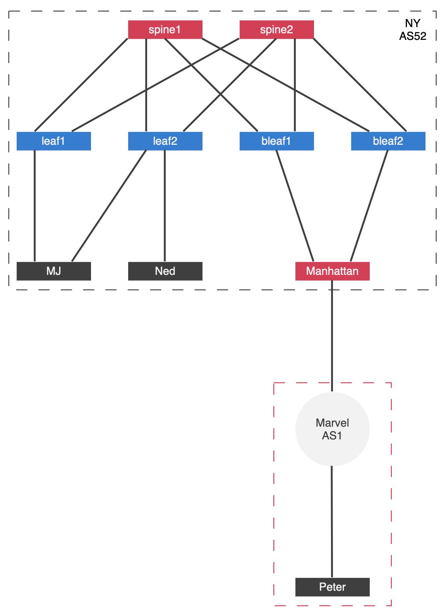
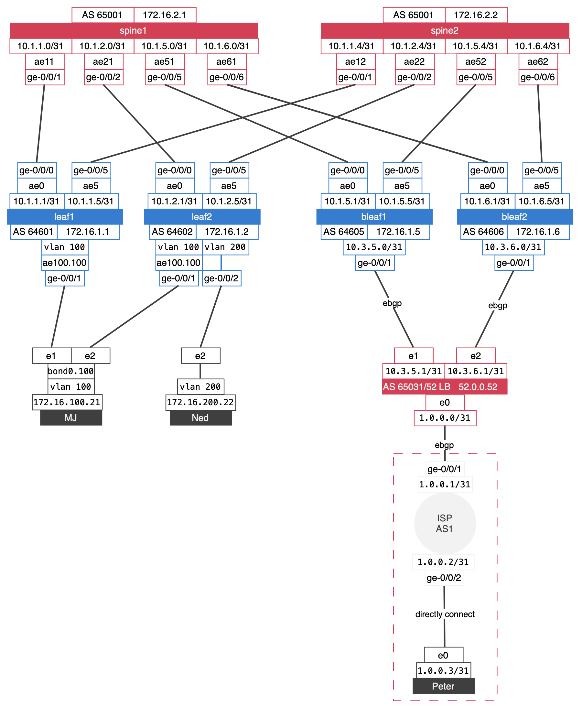
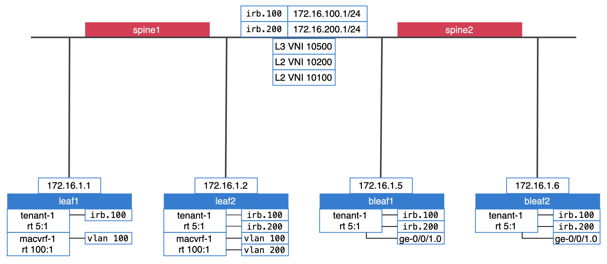
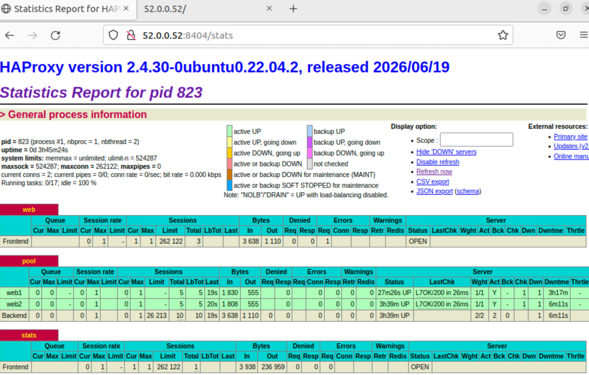

Load balancers are commonly deployed in a data center to distribute application traffic. The EVPN/VXLAN fabric is one of several options for the DC core, and it can be built in different ways depending on where VXLAN terminates. This post used the architecture where VXLAN terminates on the leaf, and Figure 1 and 2 shows the lab topology. The goal is for Peter to reach MJ and Ned through Manhattan. Files are available in [git](https://github.com/ildarinho/netflash_files/tree/main/Load-Balancing-on-HAproxy-in-EVPN).

>The lab was built in EVE-NG using vMX running Junos 23.2R2, which supports MAC-VRF (introduced in 20.4R1). The lab is IPv4 only. If you don't have the opportunity to set it up, all configs, show command output, and packet captures are available in my git.
{: .prompt-info }

### Topology overview:


_Figure 1_

_Figure 2_
NY DC is built using an ERB overlay design with an IPv4 eBGP underlay where Leafs have their own unique ASN and all spines share the same ASN. Leaf links that are connected to Spine include in their own aggregated Ethernet interfaces that make our lab look more production style. NY has its own PI address pool and AS52, and also includes a load balancer named Manhattan. 
Manhattan has connections to border leaf1, leaf 2 and ISP router via eBGP. Load balancer works on ubuntu server 22.04 and used FRR for routing and HAproxy for load balancer task with public ip address 52.0.0.52 that send to ISP via eBGP

Peter is a Ubuntu 22.04 desktop client connected to an ISP called Marvel within AS1. MJ and Ned are two Ubuntu 22.04 servers, each running a web server that returns info, which server responds. MJ is multihomed to Leaf1 and Leaf2 through an aggregated Ethernet interface, while Ned is connected to Leaf2.

> To make bond work in 


_Figure 3_
NY DC uses an ERB overlay design with symmetric IRB and a routed overlay with Type-5 routing, where the MAC-VRF is configured with the VLAN-aware service type. EVPN Type-2 MAC and MAC+IP handles intra reachability within a VLAN, and EVPN Type-5 handles inter reachability across IRB interfaces related to the VLAN. Leaf1 has an IRB interfaces related to VLAN 100 and Leaf2 has a both IRB interfaces related to VLAN 100 and VLAN 200. Bleaf1 and Bleaf2 as Leaf2 have both IRB interfaces, and also have an interface ge-0/0/1 connected to the LB and assigned to the tenant-1 VRF.

The topology overview is finished. Here is the list of commands that I used to collect the information:
```bash
show lacp interfaces extensive
show interfaces
show interfaces ae100 extensive
show bridge domain
show bridge mac-table
show route
show route forwarding-table
show route table bgp.evpn.0 extensive
show mac-vrf forwarding instance extensive
show mac-vrf forwarding flood
show mac-vrf forwarding mac-table
show mac-vrf forwarding mac-ip-table
show mac-vrf forwarding vxlan-tunnel-end-point remote
show mac-vrf forwarding vxlan-tunnel-end-point esi
show policy __vrf-import-__default_evpn__-internal__
show policy __vrf-import-macvrf-1-internal__
show mac-vrf routing database
show bgp summary
show route forwarding-table
show system connections | match 179
show evpn database
show evpn database extensive
show evpn instance macvrf-1 extensive
```

### Load balancers
Manhattan is a load balancer built on an Ubuntu server, running FRR and HAproxy

FRR conf:
```bash
frr version 10.6.1
frr defaults traditional
hostname loadbalncer
log syslog informational
no ip forwarding
no ipv6 forwarding
service integrated-vtysh-config
!
ip prefix-list lo-lb seq 31 permit 10.3.31.1/32
ip prefix-list new-52 seq 52 permit 52.0.0.0/24
!
route-map ALLOW-IN permit 10
exit
!
route-map default-in permit 10
exit
!
route-map prefix-announce permit 10
 match ip address prefix-list new-52
exit
!
route-map prefix-announce deny 100
exit
!
route-map prefix-default permit 5
 match ip address prefix-list lo-lb
exit
!
route-map prefix-default deny 10
exit
!
ip route 52.0.0.0/24 Null0
!
router bgp 65031
 bgp router-id 52.0.0.1
 no bgp enforce-first-as
 no bgp hard-administrative-reset
 no bgp graceful-restart notification
 bgp bestpath as-path multipath-relax
 neighbor 1.0.0.1 remote-as 1
 neighbor 1.0.0.1 local-as 52 no-prepend replace-as
 neighbor 10.3.5.0 remote-as 64605
 neighbor 10.3.6.0 remote-as 64606
 !
 address-family ipv4 unicast
  network 10.3.31.1/32
  network 52.0.0.0/24
  neighbor 1.0.0.1 route-map ALLOW-IN in
  neighbor 1.0.0.1 route-map prefix-announce out
  neighbor 10.3.5.0 route-map default-in in
  neighbor 10.3.5.0 route-map prefix-default out
  neighbor 10.3.6.0 route-map default-in in
  neighbor 10.3.6.0 route-map prefix-default out
 exit-address-family
exit
```
HAproxy conf:
```bash
frontend web
        bind 52.0.0.52:80
        default_backend pool

backend pool
        balance roundrobin
        option httpchk GET /
        source 10.3.31.1
	server web1 172.16.100.10:80 check
        server web2 172.16.200.20:80 check

frontend stats
        bind 52.0.0.52:8404
        stats enable
        stats uri /stats
        stats refresh 5s
```
> HAproxy work in http mode
{: .prompt-info }

MJ and Ned are deployed as systemd web services that return the server name on an HTTP request.

```bash
echo "<h1>Server1</h1>" > /home/www/index.html

tee /etc/systemd/system/webtest.service >/dev/null <<'EOF'
[Unit]
Description=Lab test backend (static banner on :80)
After=network.target

[Service]
WorkingDirectory=/home/www
ExecStart=/usr/bin/python3 -m http.server 80
Restart=always

[Install]
WantedBy=multi-user.target
EOF
```

### Test LB
The full flow is here:

_Figure 4_
Peter initiates a TCP connection with 52.0.0.52 and keeps it open for the purpose of sending HTTP requests and receiving responses.
Manhattan, running HAproxy, receives the HTTP request from Peter and writes it into the request buffer. Then HAproxy round-robin algorithm selects between MJ and Ned. Manhattan establishes a TCP connection from 10.3.31.1 to Ned and sends the request from the request buffer. Ned response is received into the stream response buffer and then sent back to Peter over the original frontend connection.

Here is how the HAproxy stats look:

_Figure 5_

Let's be happy for Peter! After saving New York and Earth so many times, he deserves to stay in touch with friends.
